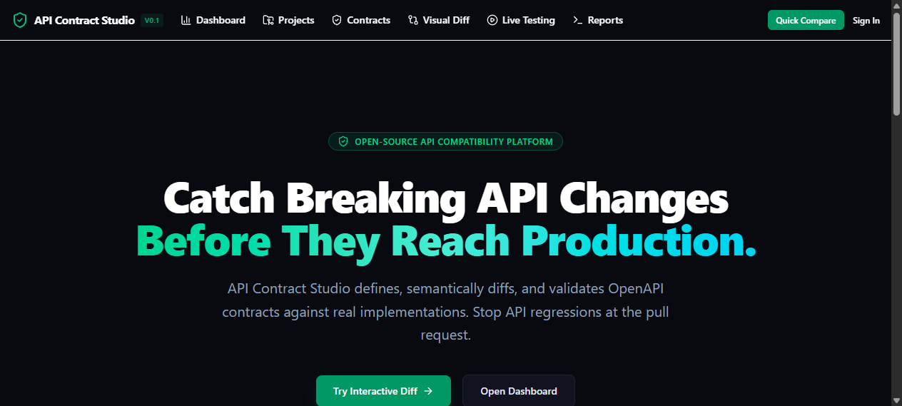
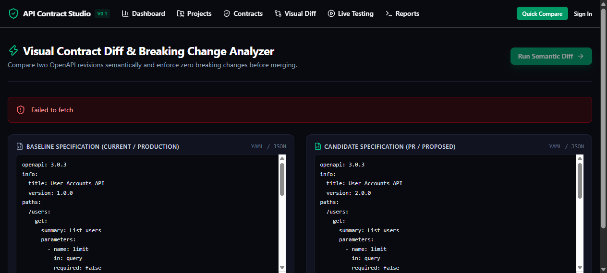

# API Contract Studio

> **"Catch Breaking API Changes Before They Reach Production."**

API Contract Studio is an open-source platform for defining, validating, testing, comparing, and monitoring API contracts. It detects breaking changes before deployment, validates API implementations against OpenAPI specifications, and integrates contract validation directly into CI/CD pipelines.



---

## Key Features

- **Semantic OpenAPI Diff Engine**: Detects endpoint removals, method removals, required parameter additions, schema type changes, narrowed enums, and response property removals across OpenAPI 3.0.x and 3.1.x.
- **Interactive Visual Diff Explorer**: Web UI to inspect contract changes with severity filters, compatibility tags, JSON Pointer locations, and remediation recommendations.



- **Standalone CLI (`acs`)**: Zero-server local contract validation and diffing with deterministic exit codes (`0`, `1`, `2`, `3`).
- **Live Contract Testing**: Verifies real service responses against OpenAPI schemas with strict SSRF defense.
- **Immutable Contract Revisioning**: Prevents silent history overwrites; restores create audited new revisions.
- **CI/CD Integration**: Pre-configured GitHub Actions workflow for pull-request gating with Markdown step summaries.

---

## Quick Start (CLI)

### 1. Installation

```bash
# Clone the repository
git clone https://github.com/0xyz-exe/api-contract-studio.git
cd api-contract-studio

# Create virtual environment and install CLI
uv venv --python 3.12 .venv
source .venv/bin/activate  # Windows: .venv\Scripts\activate
uv pip install -e ".[api,dev]"
```

### 2. Validate an OpenAPI Specification

```bash
acs validate contracts/examples/baseline_petstore.yaml
```

### 3. Run Semantic Contract Diff

```bash
acs diff contracts/examples/baseline_petstore.yaml contracts/examples/candidate_breaking.yaml
```

Output:
```text
API Contract Studio Diff: FAILED
Baseline:  Petstore Service (1.0.0)
Candidate: Petstore Service (2.0.0)

Changes:   Total=5 | Breaking=5 | Potentially Breaking=0 | Non-Breaking=0
Severity:  Critical=2 | High=3 | Medium=0 | Low=0

Findings:
  🚨 [CRITICAL] ACS-PATH-REMOVED at #/paths//pets/{petId} [FAILS CI]
     Message:     Path '/pets/{petId}' was removed from the API.
     Remediation: Restore path '/pets/{petId}' or deprecate it before removal.
  🚨 [HIGH] ACS-REQ-PARAM-ADDED-REQUIRED at #/paths//pets/get/parameters/tenant_id [FAILS CI]
     Message:     New required parameter 'tenant_id' added to GET /pets.
     Remediation: Make parameter 'tenant_id' optional with a sensible default value.
```

---

## Web Platform & Local Development

### Starting Backend & Frontend

```bash
# 1. Apply database migrations
uv run alembic upgrade head

# 2. Start FastAPI Backend (Port 8000)
uv run uvicorn apps.api.app.main:app --reload --port 8000

# 3. In another terminal, start Next.js Frontend (Port 3000)
cd apps/web
npm install --ignore-scripts
npm run dev
```

Visit `http://localhost:3000` to access the interactive web interface.

### Docker Compose

```bash
docker compose up -d
```

---

## Testing

```bash
# Run all unit, integration, and security tests (34 tests)
uv run pytest -v

# Run frontend production build
cd apps/web && npm run build
```

---

## Architecture

See [docs/architecture.md](docs/architecture.md) for details on design and data flow.
See [docs/breaking-change-rules.md](docs/breaking-change-rules.md) for the catalog of implemented compatibility rules.
See [docs/cli.md](docs/cli.md) for the complete CLI manual.
See [docs/ci-cd.md](docs/ci-cd.md) for GitHub Actions integration.
See [docs/security.md](docs/security.md) for SSRF defense and credential handling.

---

## License

[Apache-2.0](LICENSE) © API Contract Studio Contributors.
